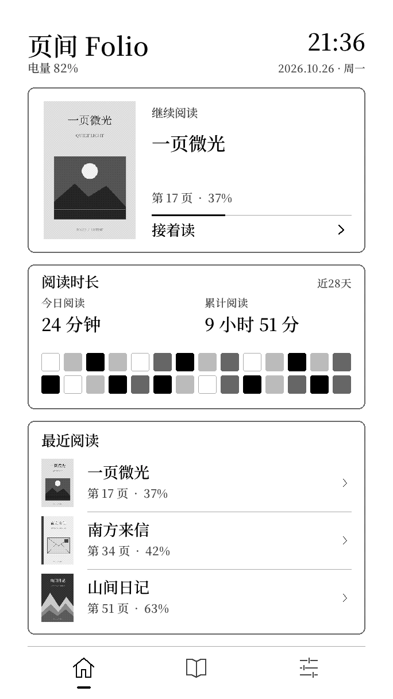
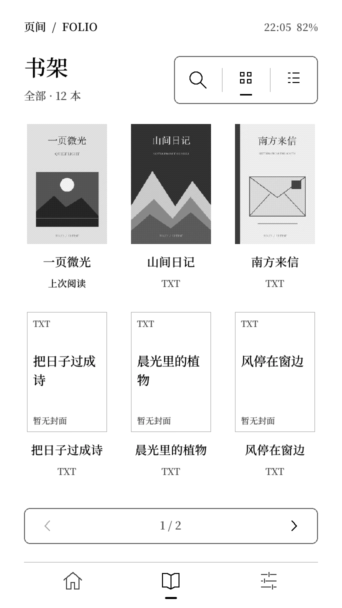
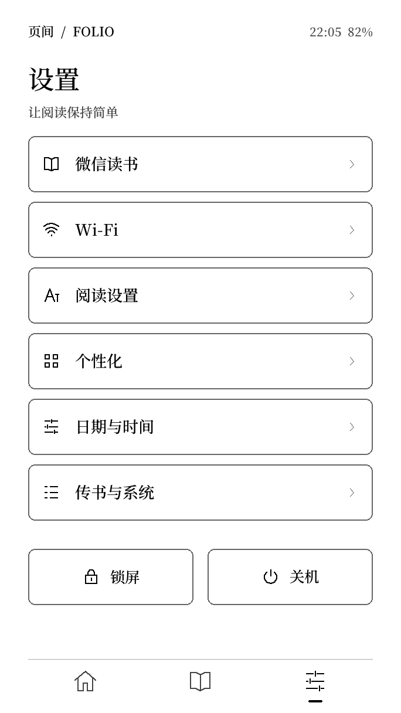

Thank you to [Muki](https://github.com/qmqsu) for providing a system for Read Pico.

Folio is a third-party firmware focused on reading. Read TXT and EPUB books from a TF card, transfer books from your phone, adjust fonts and layout, and view reading statistics. Local books work offline. The system also includes experimental WeRead support, custom wallpapers, and on-device updates.

<figure className="mx-auto w-full max-w-xs">
  
  <figcaption>Home screen</figcaption>
</figure>

## Before you start

Folio supports only Read Pico (RDP-G01-W). Prepare a sufficiently charged device, a computer running desktop Chrome or Edge, and a USB-C data cable. Close other webpages, flashing tools, or terminals using the device's serial port.

Prepare a FAT32 microSD (TF) card for books, fonts, and images. Installation replaces the current system, and settings and reading records from another system are not guaranteed to be compatible. Before installing, read the [compatibility, backup, and recovery instructions](https://github.com/qmqsu/folio/blob/main/docs/%E5%88%B7%E6%9C%BA%E8%AF%B4%E6%98%8E.md) and save important books, reading records, and device data.

## Install through the website

<Steps>
<Step>

### Open the website and start installation

Open the [Folio website](https://qmqsu.github.io/folio/) in desktop Chrome or Edge and click 一键刷入 (Install) in the 刷机 (Flash) section. Check the system name, release channel, and version shown on the page.

</Step>
<Step>

### Connect the device and check the installation details

Connect Read Pico with a USB data cable and select its serial port in the browser dialog. Follow the guide to confirm the device model, images, and partition layout. The page verifies the release signature and images, and rejects unknown chips or unverified layouts.

</Step>
<Step>

### Wait for installation to finish

Keep USB connected, the page open, and the computer awake until writing and on-device verification finish. Do not disconnect the cable, close the page, or let the computer sleep. Restart the device as directed when complete.

Web installation does not actively erase the TF card or require a full Flash backup download. After cancellation or disconnection, follow the status shown on the page. For recovery, use your own backup and the corresponding recovery instructions.

</Step>
<Step>

### Prepare the card and start reading

Place `books`, `fonts`, and `picture` folders in the TF card root for books, custom fonts, and images. The hidden `.folio` folder stores reading positions, bookmarks, caches, and statistics; do not delete the entire folder when cleaning up update files.

Insert the card, start the device, and open a book from the bookshelf. Connect the device to Wi-Fi before using transfers or online features.

</Step>
</Steps>

## Main features

### Local reading and bookshelf

Read TXT and EPUB with a table of contents, bookmarks, covers, resuming where you left off, and bookshelf search and sorting. The home screen lets you resume reading and shows recent books and reading time. EPUB support currently focuses on text, the table of contents, and covers; inline image layouts, CSS, fixed layouts, and DRM are not yet supported.

  <figure>
    
    <figcaption>Bookshelf</figcaption>
  </figure>
  <figure>
    
    <figcaption>Reading</figcaption>
  </figure>

### Layout and personalization

Adjust fonts, text size, line spacing, margins, and alignment. A built-in Song typeface is available alongside custom fonts, and remains the fallback when separate font resources are unavailable. Lock-screen and power-off wallpapers can be customized.

### Phone transfers and WeRead

With the phone and Read Pico on the same Wi-Fi network, use a browser to upload books, images, and fonts in batches. WeRead support is experimental: sign in to your own account, view your bookshelf, and download books for offline reading. It uses a non-public protocol, may stop working if the upstream service changes, and is not an official Tencent client.

<figure className="mx-auto w-full max-w-xs">
  
  <figcaption>Settings</figcaption>
</figure>

### Updates

After the initial installation, manually check for stable updates on the device, then download and confirm installation. When the network is unavailable, you can update from a TF card by following the [installation instructions](https://github.com/qmqsu/folio/blob/main/docs/%E5%88%B7%E6%9C%BA%E8%AF%B4%E6%98%8E.md). Do not use an application update package as a full first-installation image or mix files from different systems.

## Source code

<GithubInfo owner="qmqsu" repo="folio" />

## Installation and usage help

<Cards>
  <Card href="/docs/read_0/faq/firmware_install" title="Installation and Usage FAQ">Find help with storage cards, serial connections, and slow or frozen screens after installation.</Card>
  <Card href="/docs/read_0/firmware" title="Restore the Official Demo System">Follow the build and flash instructions in DIY Your System to restore the official demo system.</Card>
</Cards>
