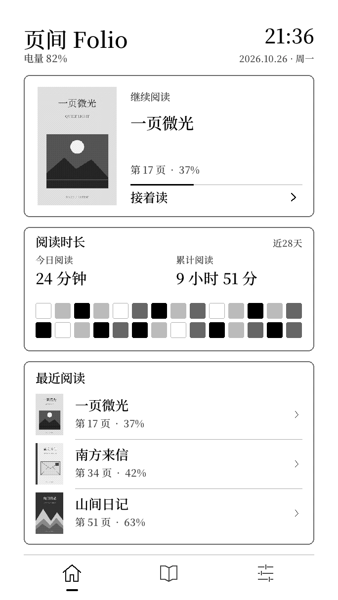
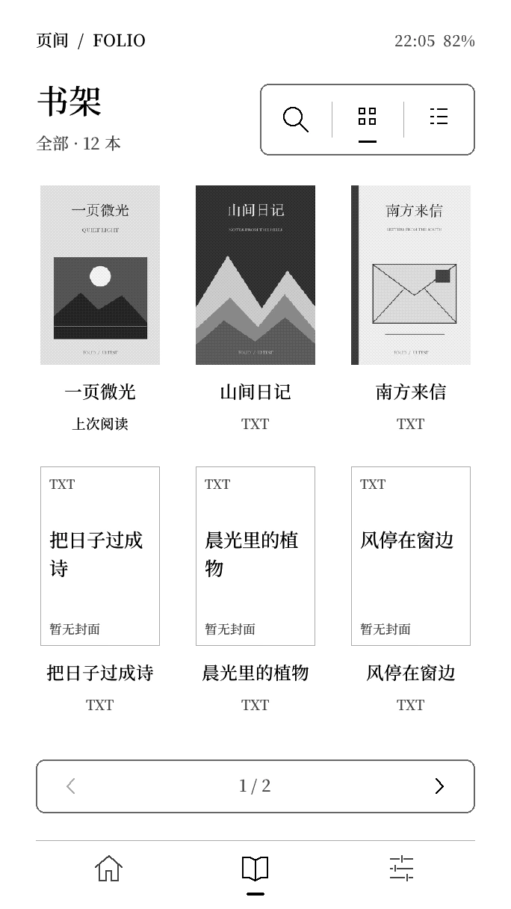
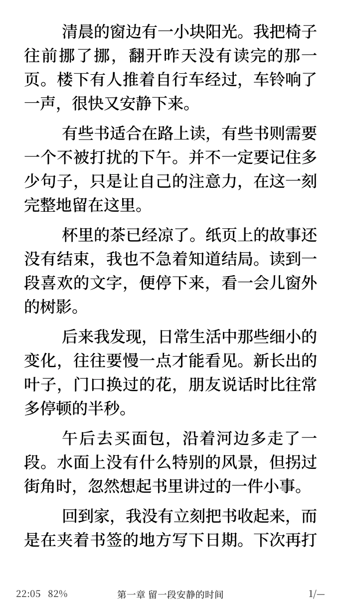
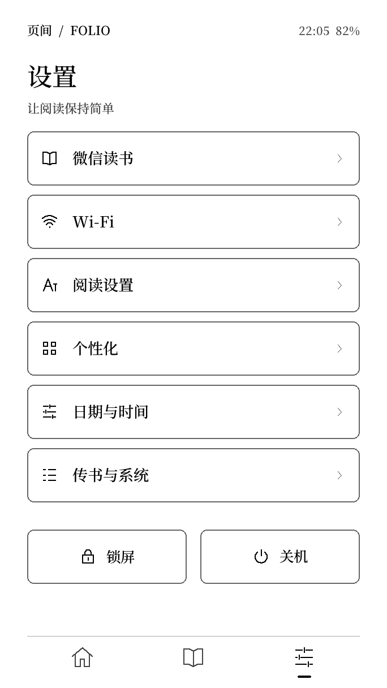

Read Pico 向けにシステムを提供してくださった [Muki](https://github.com/qmqsu) に感謝します。

页间 Folio は読書を中心に据えたサードパーティーファームウェアです。TF カード内の TXT と EPUB を読み、スマートフォンから書籍を転送し、フォントや組版を調整して、読書統計を確認できます。ローカルの書籍はオフラインで読めます。試験的な WeRead、カスタム壁紙、端末上での更新にも対応します。

<figure className="mx-auto w-full max-w-xs">
  
  <figcaption>ホーム画面</figcaption>
</figure>

## はじめる前に

Folio が対応するのは Read Pico（RDP-G01-W）だけです。十分に充電した端末、デスクトップ版 Chrome または Edge を使うパソコン、データ通信対応の USB-C ケーブルを用意してください。端末のシリアルポートを使用している他のページ、書き込みツール、ターミナルは閉じてください。

書籍、フォント、画像を保存する FAT32 形式の microSD（TF）カードを用意してください。インストールすると現在のシステムが置き換わり、別のシステムの設定や読書記録を引き継げるとは限りません。事前に[対応範囲・バックアップ・復元の説明](https://github.com/qmqsu/folio/blob/main/docs/%E5%88%B7%E6%9C%BA%E8%AF%B4%E6%98%8E.md)を読み、大切な書籍、読書記録、端末データを保存してください。

## 公式サイトからインストールする

<Steps>
<Step>

### 公式サイトを開いてインストールを始める

パソコンの Chrome または Edge で [Folio 公式サイト](https://qmqsu.github.io/folio/)を開き、「刷机」（書き込み）の「一键刷入」（ワンクリックインストール）を押します。表示されたシステム名、リリースチャンネル、バージョンを確認してください。

</Step>
<Step>

### 端末を接続して内容を確認する

USB データケーブルで Read Pico を接続し、ブラウザーの一覧から端末のシリアルポートを選びます。案内に従って端末モデル、イメージ、パーティション構成を確認してください。ページはリリース署名とイメージを検証し、不明なチップや未確認の構成への書き込みを拒否します。

</Step>
<Step>

### 完了まで待つ

書き込みと端末側の検証が完了するまで、USB を接続し、ページを開いたままにし、パソコンをスリープさせないでください。途中でケーブルを抜いたり、ページを閉じたりしないでください。完了後は案内に従って端末を再起動します。

Web インストールで TF カードを消去する操作は行われず、Flash 全体のバックアップのダウンロードも必須ではありません。キャンセルや切断後の状態はページの表示に従って確認してください。復元には、自分で事前に保存したバックアップと対応する手順を使います。

</Step>
<Step>

### カードを用意して読書を始める

TF カードのルートに `books`、`fonts`、`picture` を置き、それぞれ書籍、追加フォント、画像を保存します。隠しフォルダー `.folio` には読書位置、しおり、キャッシュ、統計が保存されます。更新ファイルを整理するためにフォルダー全体を削除しないでください。

カードを挿入して端末を起動し、本棚から本を開きます。転送やオンライン機能を使う前に、端末を Wi-Fi に接続してください。

</Step>
</Steps>

## 主な機能

### ローカル読書と本棚

TXT と EPUB に対応し、目次、しおり、表紙、前回の続きから読む機能、本棚の検索と並べ替えを利用できます。ホーム画面では前回の続きを開き、最近読んだ本や読書時間を確認できます。EPUB は現在、本文の文字、目次、表紙を中心に対応しており、本文内の画像レイアウト、CSS、固定レイアウト、DRM には対応していません。

  <figure>
    
    <figcaption>本棚</figcaption>
  </figure>
  <figure>
    
    <figcaption>本文画面</figcaption>
  </figure>

### 組版とカスタマイズ

フォント、文字サイズ、行間、余白、配置を調整できます。宋体フォントを内蔵し、追加フォントも利用できます。独立フォントリソースを利用できない場合は宋体に戻ります。ロック画面と電源オフの壁紙も設定できます。

### スマートフォンからの転送と WeRead

スマートフォンと Read Pico を同じ Wi-Fi に接続すると、ブラウザーから書籍、画像、フォントをまとめて転送できます。WeRead は試験機能で、自分のアカウントにログインして本棚を表示し、書籍をダウンロードしてオフラインで読めます。非公開プロトコルを使用するため、上流サービスの変更で利用できなくなる可能性があり、Tencent 公式クライアントではありません。

<figure className="mx-auto w-full max-w-xs">
  
  <figcaption>設定</figcaption>
</figure>

### 更新

初回インストール後は、端末で安定版の更新を手動確認し、ダウンロードしてインストールを承認できます。ネットワークを利用しにくい場合は、[インストールの説明](https://github.com/qmqsu/folio/blob/main/docs/%E5%88%B7%E6%9C%BA%E8%AF%B4%E6%98%8E.md)に従って TF カードから更新できます。アプリ更新パッケージを初回インストール用の完全イメージとして使ったり、異なるシステムのファイルを混在させたりしないでください。

## ソースコード

<GithubInfo owner="qmqsu" repo="folio" />

## インストールと使用のヘルプ

<Cards>
  <Card href="/docs/read_0/faq/firmware_install" title="インストールと使用のよくある質問">ストレージカード、シリアル接続、インストール後の動作停止などの対処方法を確認できます。</Card>
  <Card href="/docs/read_0/firmware" title="公式デモシステムに戻す">「自分だけのシステムを作る」のビルド・書き込み手順で、公式デモシステムに戻せます。</Card>
</Cards>
