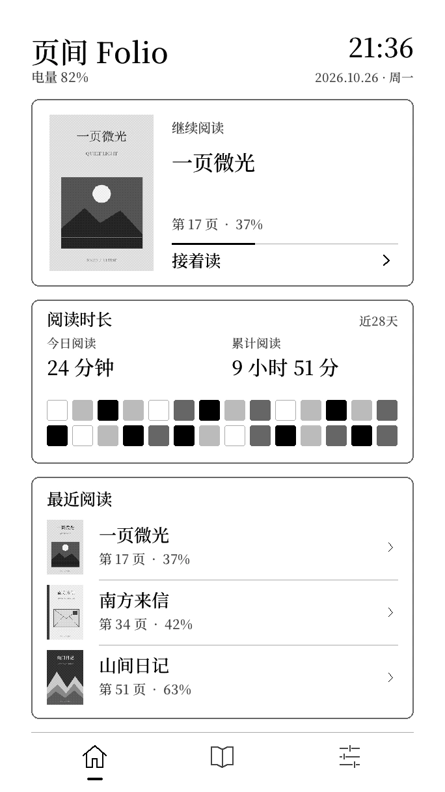
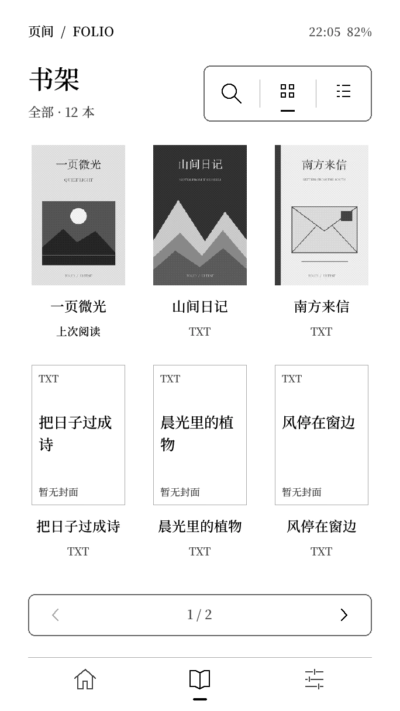
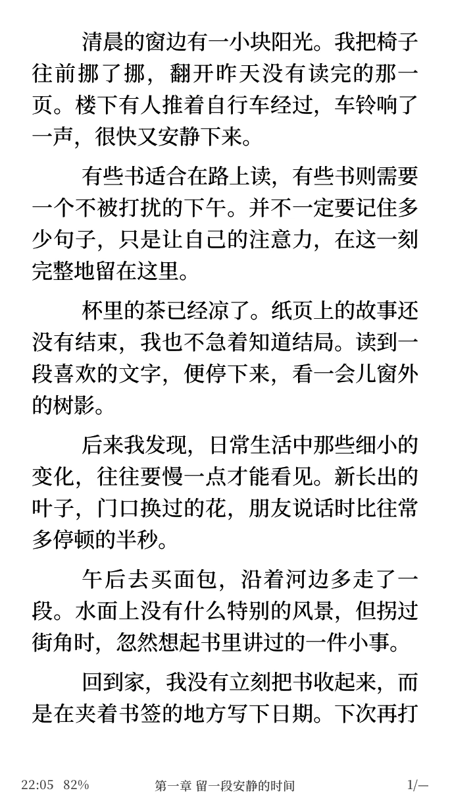
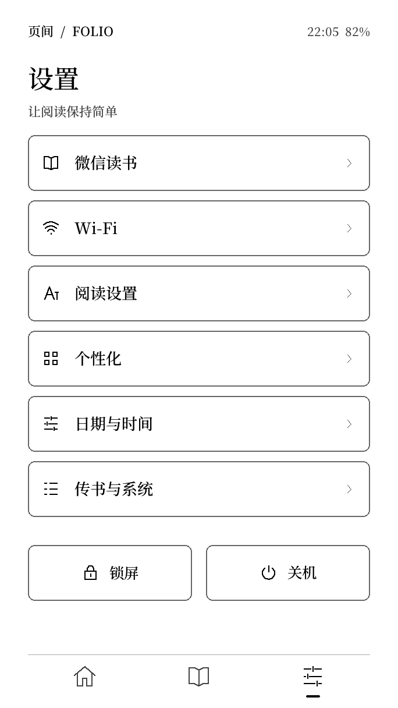

感谢 [Muki](https://github.com/qmqsu) 为小纸 Pico 提供系统。

页间 Folio 是一款以阅读为核心的第三方固件。你可以阅读 TF 卡中的 TXT 和 EPUB，从手机传书，调整字体与排版，并查看阅读统计。本地书籍不联网也能阅读；系统还提供实验性微信读书、自定义壁纸和设备内更新。

<figure className="mx-auto w-full max-w-xs">
  
  <figcaption>首页</figcaption>
</figure>

## 开始之前

页间 Folio 仅支持小纸 Pico（RDP-G01-W）。准备电量充足的设备、使用桌面版 Chrome 或 Edge 的电脑，以及支持数据传输的 USB-C 数据线。关闭其他占用设备串口的网页、刷写工具或终端。

请准备 FAT32 格式的 microSD（TF）卡，用于保存书籍、字体和图片。安装会替换当前系统，原系统的设置和阅读记录不保证兼容。安装前请阅读[适配、备份与恢复说明](https://github.com/qmqsu/folio/blob/main/docs/%E5%88%B7%E6%9C%BA%E8%AF%B4%E6%98%8E.md)，保存重要的书籍、阅读记录和需要保留的设备数据。

## 通过官网安装

<Steps>
<Step>

### 打开官网并选择一键刷入

在电脑的 Chrome 或 Edge 中打开[页间 Folio 官网](https://qmqsu.github.io/folio/)，在「刷机」区域点击「一键刷入」。核对页面显示的系统名称、发布通道和版本。

</Step>
<Step>

### 连接设备并核对安装信息

用 USB 数据线连接小纸 Pico，在浏览器弹窗中选择设备串口。按向导确认设备型号、镜像和分区布局；网页会校验发布签名与镜像，并拒绝未知芯片或未核对的布局。

</Step>
<Step>

### 等待安装完成

保持 USB 连接、页面打开和电脑唤醒，等待写入与设备端校验完成。期间不要拔线、关闭页面或让电脑进入睡眠。完成后按页面提示重启设备。

网页安装不主动擦除 TF 卡，也不强制下载完整 Flash 备份。取消或断线后的状态应以页面提示为准；需要恢复时，使用自己事先保存的备份和对应恢复说明。

</Step>
<Step>

### 准备存储卡并开始阅读

在 TF 卡根目录放置 `books`、`fonts`、`picture`，分别保存书籍、自备字体和图片。隐藏的 `.folio` 保存阅读进度、书签、缓存和统计，不要为了清理更新文件而删除整个目录。

插入存储卡并启动设备，从书架打开图书。需要传书或在线功能时，先在设备上连接 Wi-Fi。

</Step>
</Steps>

## 主要功能

### 本地阅读与书架

支持 TXT 和 EPUB，提供目录、书签、封面、续读、书架搜索与排序。首页可以继续上次阅读，并查看最近阅读和阅读时长。EPUB 目前以文字、目录和封面为主，暂不支持正文图片布局、CSS、固定排版和 DRM。

  <figure>
    
    <figcaption>书架</figcaption>
  </figure>
  <figure>
    
    <figcaption>正文阅读</figcaption>
  </figure>

### 排版与个性化

可调整字体、字号、行距、页边距和对齐方式。应用自带宋体，也可使用自备字体；独立字体资源不可用时回退宋体。支持设置锁屏与关机壁纸。

### 手机传书与微信读书

手机和小纸 Pico 连接同一 Wi-Fi 后，可通过浏览器批量上传书籍、图片和字体。微信读书为实验功能，可登录自己的账号、查看书架并下载后离线阅读；它使用非公开协议，可能随上游变化失效，不是腾讯官方客户端。

<figure className="mx-auto w-full max-w-xs">
  
  <figcaption>设置</figcaption>
</figure>

### 更新

首次安装后，可在设备上手动检查稳定版更新，下载并确认安装。网络不方便时，也可按[安装说明](https://github.com/qmqsu/folio/blob/main/docs/%E5%88%B7%E6%9C%BA%E8%AF%B4%E6%98%8E.md)使用 TF 卡升级。不要将应用更新包当作首次安装的完整镜像，也不要混用不同系统的文件。

## 项目源码

<GithubInfo owner="qmqsu" repo="folio" />

## 安装与使用帮助

<Cards>
  <Card href="/docs/read_0/faq/firmware_install" title="安装与使用常见问题">查看存储卡、串口连接和安装后卡顿等问题的处理方法。</Card>
  <Card href="/docs/read_0/firmware" title="恢复官方演示系统">前往 DIY 你的系统，按编译与刷写步骤恢复官方演示系统。</Card>
</Cards>
